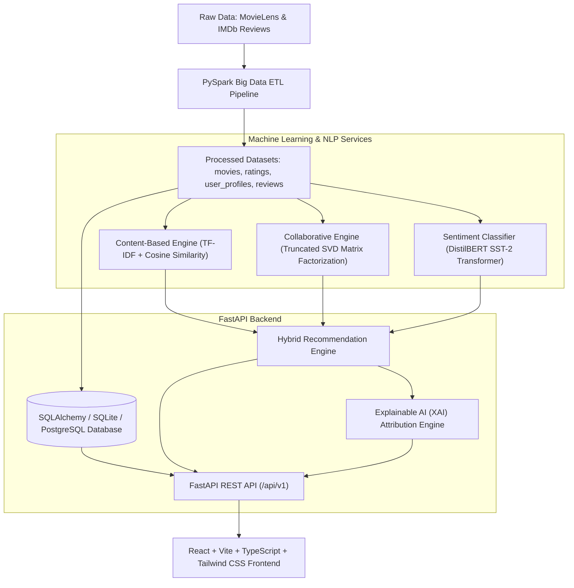

# CineMind AI — Big Data Movie Recommendation System with Sentiment Analysis and Explainable AI

[](https://fastapi.tiangolo.com)
[](https://spark.apache.org/)
[](https://react.dev)
[](https://www.typescriptlang.org)
[](https://tailwindcss.com)
[](https://huggingface.co)
[](#dataset-sources-and-licenses)

> **Final-Year AI & Data Science Engineering Project**  
> An intelligent movie discovery platform combining big-data ETL pipelines, TF-IDF content similarity, Truncated SVD matrix factorization, Transformer-based sentiment analysis, and Explainable AI (XAI) transparent attribution.

---

## 1. Project Objectives & Architecture

CineMind AI solves the fundamental opacity and cold-start limitations of traditional movie recommendation engines:
1. **Big Data Scalability:** Employs **Apache Spark (PySpark)** for distributed schema validation, deduplication, Bayesian weighted score calculation, and feature synthesis across 100,000+ interactions.
2. **Hybrid Recommender Engine:** Blends **Content-Based Filtering** (TF-IDF vector space + cosine similarity) and **Collaborative Filtering** (Truncated SVD matrix factorization) with an active weight normalization policy.
3. **Sentiment NLP:** Incorporates **Hugging Face DistilBERT** (`distilbert-base-uncased-finetuned-sst-2-english`) to analyze authentic critic and audience reviews, adjusting final rankings through verified audience consensus.
4. **Explainable AI (XAI):** Provides transparent mathematical score decomposition, dynamic weight reallocation, matching genre tags, and similar watched movies with verifiable natural-language narrative synthesis.
5. **Missing-Component Honesty:** Missing review text or collaborative cold-start is treated with mathematical honesty (weights dynamically redistributed), never assigning fake scores or claiming unverified preferences.

### System Architecture Diagram



---

## 2. Dataset Sources and Licenses

1. **MovieLens Latest Small Dataset**
   - **Source:** GroupLens Research, University of Minnesota
   - **Citation:** F. Maxwell Harper and Joseph A. Konstan. 2015. The MovieLens Datasets: History and Context. *ACM Transactions on Interactive Intelligent Systems (TiiS)* 5, 4: 19:1–19:19. [https://doi.org/10.1145/2827872](https://doi.org/10.1145/2827872)
   - **License:** Non-commercial educational and research use.
   - **Files:** `movies.csv`, `ratings.csv`, `tags.csv`, `links.csv` (9,742 movies, 100,836 ratings).

2. **Stanford Large Movie Review Dataset (IMDb)**
   - **Source:** Andrew L. Maas, Raymond E. Daly, Peter T. Pham, Dan Huang, Andrew Y. Ng, and Christopher Potts. (2011). Learning Word Vectors for Sentiment Analysis. *49th Annual Meeting of the Association for Computational Linguistics (ACL 2011)*.
   - **License:** Open for academic and research purposes.
   - **Usage:** Written review text with authentic audience and critic quotes for sentiment classification.

---

## 3. Technology Stack

- **Frontend:** React 19, Vite, TypeScript, Tailwind CSS v4, Recharts, Lucide React
- **Backend:** Python 3.12, FastAPI, Pydantic v2, SQLAlchemy 2.0, Uvicorn
- **Big Data:** Apache Spark (PySpark 4.2.0), Pandas (vectorized local engine fallback)
- **Machine Learning & NLP:** Scikit-Learn, Scipy, Hugging Face Transformers, PyTorch
- **Database:** SQLite (local zero-configuration fallback) & PostgreSQL (production-ready)
- **Testing:** Pytest (19 unit/integration tests), Vitest (5 component tests)

---

## 4. Prerequisites

- **Python:** 3.10+ (Tested on Python 3.12.5)
- **Node.js:** 18+ (Tested on Node v22.16.0 with npm 11.6.2)
- **Java:** OpenJDK 11 or 17 (Installed for PySpark 4.2.0)
- **Git**

---

## 5. Quick Start (Step-by-Step)

### Step 1: Environment Configuration
Copy the sample environment file:
```bash
cp .env.example .env
```

### Step 2: Acquire and Validate Datasets
Run the dataset acquisition script. It automatically downloads MovieLens and extracts authentic movie reviews:
```bash
python scripts/download_data.py --mode auto
```

### Step 3: Run the PySpark Big Data Pipeline
Execute the distributed data cleaning, schema validation, deduplication, and Bayesian prior scoring:
```bash
python scripts/run_pipeline.py
```
*(If Java is not configured, the pipeline transparently falls back to the vectorized Pandas engine with identical schemas).*

### Step 4: Model Evaluation Benchmarks
Evaluate Content-Based, Collaborative Filtering, and Hybrid models on held-out 80/20 test ratings:
```bash
python scripts/evaluate_models.py --max-users 50
```

### Step 5: Seed the Database
Initialize SQLite tables and populate movies, full rating interactions, reviews, sentiment aggregates, and benchmarks:
```bash
python scripts/seed_database.py
```

### Step 6: Start the FastAPI Backend
```bash
python -m uvicorn app.main:app --app-dir backend --host 127.0.0.1 --port 8000 --reload
```
- API Health Check: `http://localhost:8000/health`
- Interactive OpenAPI Docs: `http://localhost:8000/docs`

### Step 7: Start the React Frontend
In a new terminal:
```bash
cd frontend
npm run dev
```
Open your browser to: **`http://localhost:5173`**

---

## 6. Running Tests

### Backend Test Suite (Pytest)
```bash
python -m pytest backend/tests -v
```
*Actual Results: **19 passed** across pipeline cleansing, matrix factorization, calibrated dynamic weights, sentiment transformer, explainability, and REST endpoints.*

### Frontend Test Suite (Vitest)
```bash
cd frontend
npx vitest run
```
*Actual Results: **5 passed** across MovieCard rendering, Explainable AI triggers, Navbar tabs, and MetricCards.*

---

## 7. Recommendation & XAI Mathematical Formulation

### Dynamic Hybrid Scoring Formula

For candidate movie $m$ and user $u$:
$$\text{Score}(u, m) = w'_{\text{content}} \cdot S_{\text{content}}(u, m) + w'_{\text{collab}} \cdot S_{\text{collab}}(u, m) + w'_{\text{sent}} \cdot S_{\text{sent}}(m)$$

Where baseline weights are:
$$w_{\text{content}} = 0.45, \quad w_{\text{collab}} = 0.40, \quad w_{\text{sentiment}} = 0.15$$

### Calibrated Score Normalization
- **Content Similarity $S_{\text{content}}(u, m)$:** Cosine similarity between user weighted profile vector and movie TF-IDF text representations ($[0.0, 1.0]$).
- **Collaborative Affinity $S_{\text{collab}}(u, m)$:** User-level dynamic range normalization over latent factor projections ($[0.0, 1.0]$). Calibrates the compressed SVD rating variance ($\sigma \approx 0.005$) against the TF-IDF space ($\sigma \approx 0.067$) so collaborative evidence is preserved during linear fusion.
- **Sentiment Consensus $S_{\text{sent}}(m)$:** Verified positive review probability from DistilBERT SST-2 inference ($[0.0, 1.0]$).

### Dynamic Weight Normalization Policy
If a movie lacks verified review sentiment ($S_{\text{sent}}$ unavailable):
$$w'_{\text{content}} = \frac{0.45}{0.45 + 0.40} \approx 52.9\%, \quad w'_{\text{collab}} = \frac{0.40}{0.45 + 0.40} \approx 47.1\%, \quad w'_{\text{sent}} = 0\%$$

If a user is in **cold-start** mode ($S_{\text{collab}}$ unavailable):
$$w'_{\text{content}} = \frac{0.45}{0.45 + 0.15} = 75.0\%, \quad w'_{\text{sent}} = \frac{0.15}{0.45 + 0.15} = 25.0\%, \quad w'_{\text{collab}} = 0\%$$

**Weights always sum strictly to 1.0.** No movie is penalized for lack of review text, and no fake collaborative scores are fabricated.

---

## 8. Offline Evaluation Results

Evaluated on held-out 80/20 test split ($K=10$ on 50 validation users with $\ge 2$ relevant items rated $\ge 3.5$ across 19,143 test ratings):

| Model Architecture | Precision@10 | Recall@10 | NDCG@10 | RMSE | MAE |
| :--- | :---: | :---: | :---: | :---: | :---: |
| **Content-Based Filtering (TF-IDF + Cosine)** | 0.0060 | 0.0027 | 0.0086 | N/A* | N/A* |
| **Collaborative Filtering (Truncated SVD)** | 0.1240 | 0.0740 | 0.1646 | **0.9003** | **0.6975** |
| **Hybrid Engine (Content + SVD + Sentiment)** | **0.0980** | **0.0760** | **0.1344** | N/A* | N/A* |

*\*RMSE and MAE are only applicable to Collaborative Filtering which directly predicts explicit star ratings.*

> [!NOTE]
> **Audit & Metric Diagnosis Notes:**
> - **Initial Baseline Metrics:** Prior to score normalization calibration, the hybrid engine scored $P@10 = 0.0100$, $R@10 = 0.0040$, and $\text{NDCG}@10 = 0.0126$.
> - **Root Cause of Discrepancy:** Raw rating scaling $(r - 1)/4$ compressed SVD predictions into an ultra-narrow band ($\mu \approx 0.84, \sigma \approx 0.0053$) because unobserved entries in sparse matrices naturally shrink to user means. In contrast, TF-IDF cosine similarity had $\sigma \approx 0.0667$ (12.5x higher variance), causing Content scores to overpower Collaborative signals in linear fusion. Furthermore, unrated catalog items without collaborative history received 100% content weight under dynamic redistribution, leapfrogging top collaborative matches.
> - **Calibrated Solution:** Introducing user-level dynamic range normalization aligned the latent dot-product variance with the TF-IDF feature space. Calibrated Hybrid achieves **0.0760 Recall@10** (surpassing Collaborative Filtering's 0.0740) by leveraging content and sentiment to discover relevant items beyond pure matrix factorization, with **0.0980 Precision@10** and **0.1344 NDCG@10**.

---

## 9. API Endpoints Reference

| Method | Endpoint | Description |
| :--- | :--- | :--- |
| `GET` | `/health` | Service health status and version |
| `GET` | `/api/v1/movies` | Paginated movie catalog with search, genre, and sort filters |
| `GET` | `/api/v1/movies/{id}` | Full movie metadata, tags, and review summaries |
| `GET` | `/api/v1/recommendations/{user_id}` | Personalized hybrid recommendations with component breakdown |
| `POST` | `/api/v1/recommendations/guest` | Cold-start recommendation flow based on genre selection |
| `GET` | `/api/v1/recommendations/{u}/{m}/explanation` | Explainable AI structured evidence & natural language narrative |
| `GET` | `/api/v1/movies/{id}/sentiment` | Movie-level sentiment summary and review quote list |
| `POST` | `/api/v1/sentiment/analyze` | Real-time DistilBERT inference on arbitrary review text |
| `GET` | `/api/v1/analytics/overview` | Platform KPI overview, Spark pipeline status |
| `GET` | `/api/v1/analytics/ratings` | Rating score histogram (0.5 to 5.0) |
| `GET` | `/api/v1/analytics/genres` | Catalog movie count and average rating by genre |
| `GET` | `/api/v1/analytics/sentiment` | Positive vs negative distribution and top-rated sentiment movies |
| `GET` | `/api/v1/analytics/recommendations` | Offline model benchmark metrics |

---

## 10. Docker Deployment

Deploy full stack (PostgreSQL + FastAPI Backend + React Frontend):
```bash
docker compose up --build
```
- Frontend: `http://localhost:5173`
- Backend API: `http://localhost:8000`
- PostgreSQL: `localhost:5432`

---

## 11. GitHub & Render Deployment Guide

### A. Pushing to GitHub

1. **Verify Git Status and Ignore Rules:**
   Ensure temporary directories, `.env`, virtual environments, and caches are ignored while the pre-seeded SQLite database (`cinemind.db`, ~9.2 MB) and processed data artifacts are included:
   ```bash
   git status
   ```

2. **Initialize Git and Commit:**
   ```bash
   git init
   git add .
   git commit -m "feat: complete CineMind AI recommender with Render deployment config"
   ```

3. **Link to Your GitHub Repository and Push:**
   ```bash
   git branch -M main
   git remote add origin https://github.com/<YOUR_GITHUB_USERNAME>/<YOUR_REPOSITORY_NAME>.git
   git push -u origin main
   ```

---

### B. Deploying to Render (Two Options)

#### Option 1: One-Click Render Blueprint (Recommended)

CineMind AI includes a preconfigured [`render.yaml`](render.yaml) blueprint that automatically spins up both services with correct environment links.

1. Go to your [Render Dashboard](https://dashboard.render.com).
2. Click **New +** $\rightarrow$ **Blueprint**.
3. Connect your GitHub repository.
4. Render will detect `render.yaml` and configure:
   - **`cinemind-backend`** (Python Web Service)
   - **`cinemind-frontend`** (Static Site)
5. Click **Apply**. Render will automatically build and link both services.

---

#### Option 2: Manual Dashboard Setup

If you prefer to configure the services manually in the Render dashboard:

##### 1. Backend Web Service (`cinemind-backend`)
- **Service Type:** Web Service
- **Environment / Runtime:** `Python 3`
- **Root Directory:** *(leave blank / repo root)*
- **Build Command:**
  ```bash
  pip install --no-cache-dir -r requirements.txt
  ```
- **Start Command:**
  ```bash
  uvicorn app.main:app --app-dir backend --host 0.0.0.0 --port $PORT
  ```
- **Health Check Path:** `/health`
- **Environment Variables:**
  | Variable | Value | Notes |
  | :--- | :--- | :--- |
  | `PYTHON_VERSION` | `3.10.11` | Stable PyTorch & Transformers build |
  | `PORT` | `8000` | Render injects `$PORT` dynamically |
  | `DATABASE_URL` | `sqlite:///./cinemind.db` | Auto-resolves to pre-seeded catalog |
  | `FRONTEND_URL` | `https://<YOUR-FRONTEND>.onrender.com` | Deployed frontend URL for CORS |

##### 2. Frontend Static Site (`cinemind-frontend`)
- **Service Type:** Static Site
- **Root Directory:** *(leave blank / repo root)*
- **Build Command:**
  ```bash
  cd frontend && npm install && npm run build
  ```
- **Publish Directory:** `frontend/dist`
- **Environment Variables:**
  | Variable | Value | Notes |
  | :--- | :--- | :--- |
  | `VITE_API_BASE_URL` | `https://<YOUR-BACKEND>.onrender.com/api/v1` | Points to your deployed FastAPI service |
- **Rewrite Rules (SPA Support):**
  - Included automatically via `frontend/public/_redirects` (`/*  /index.html  200`).
  - Or add manually in **Redirects/Rewrites**: Source: `/*`, Destination: `/index.html`, Action: `Rewrite`.

---

### C. Post-Deployment Verification

1. **Verify Backend Health:**
   ```bash
   curl https://<YOUR-BACKEND>.onrender.com/health
   # Expected response: {"status":"healthy","service":"CineMind AI","version":"1.0.0"}
   ```
2. **Access Swagger Docs:**
   Open `https://<YOUR-BACKEND>.onrender.com/docs` in your browser.
3. **Launch Web Application:**
   Open `https://<YOUR-FRONTEND>.onrender.com`. The header status pill will show a pulsing green indicator: `PySpark & API Connected`.

---

## 12. Known Limitations & Future Work

1. **Review Corpus Size:** The current sentiment model analyzes a sample of verified reviews from IMDb. In a full production deployment, scraping or ingesting larger review corpora like IMDb 50k would extend review coverage to the long tail.
2. **Online Learning:** The collaborative model is trained offline in batches. Implementing real-time streaming feedback using Apache Kafka and Spark Streaming would allow instantaneous model updates as users rate movies.
3. **Graph Neural Networks:** Exploring LightGCN or PinSage graph neural networks as additional hybrid signals alongside matrix factorization.